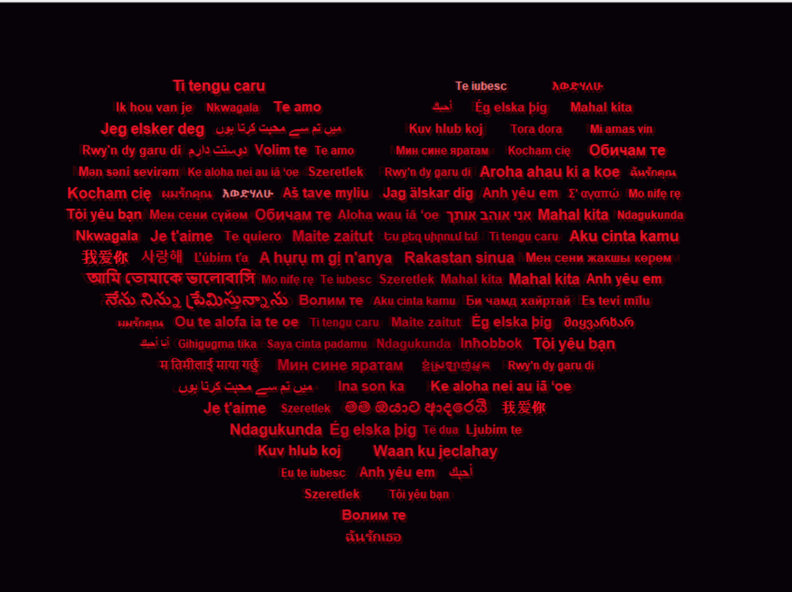

# love_heart_animation
# ❤️ Love Heart Animation

A Python animation of a heart filled with love phrases in different languages.

## ✨ Features
- Heart made of love phrases in different languages
- Animated text with red and crimson colors
- Glowing shimmer effect
- Background music

## 🛠️ Built With
- Python
- Turtle
- Tkinter
- Pygame

## ▶️ How to Run
1. Install Python.
2. Install Pygame using pip install pygame.
3. Keep love_heart_with_music.py and love_you.mp3 in the same folder.
4. Run the Python file.

## 💗 About
A creative coding project exploring animation, mathematics, and multilingual expressions of love.
